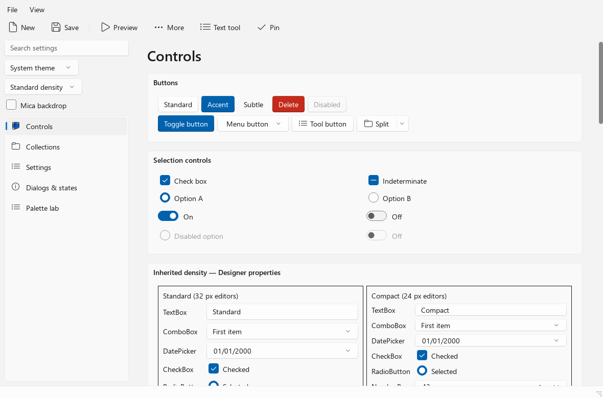
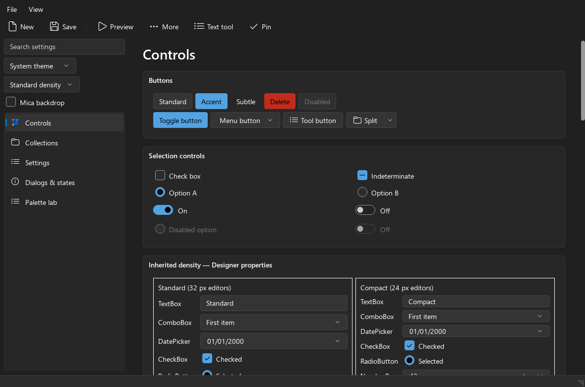

# WinUI3Style

A Qt 6 Widgets style inspired by the released WinUI 3 controls in Windows App
SDK 2.4. It provides light and dark themes, system accent colors, animated
interaction states, Standard and Compact density profiles, Fluent glyphs,
Mica main-window and opaque rounded popup surfaces, property-driven
native-widget variants, settings/navigation composition, a demo gallery,
and Qt Test coverage.




The gallery uses stock Qt widgets with no QSS; all visuals are QStyle-painted.
Deterministic offscreen captures from `winui3style_snapshot_matrix` (gallery page 0, light and dark).

The project deliberately contains no QSS. All visuals are produced by
`QStyle`, widget painting, palettes, and native Windows backdrop APIs.

## First experimental PoC

Version 0.1.0 is an experimental preview, not a claim of complete WinUI parity.
See [the PoC instructions](tools/poc/README.md) for the portable Windows x64
gallery package, deployment requirements, limitations, and publication checks.

## Build

```powershell
cmake -S . -B build -G "Visual Studio 17 2022" -A x64 `
  -DCMAKE_PREFIX_PATH=C:/Qt/6-build/qt-6.9.2-dynamic-msvc-x64
cmake --build build --config Release
ctest --test-dir build -C Release --output-on-failure
```

The same tree configures and builds on Linux (and macOS) with a Qt 6.5+
installation; only the Mica backdrop, the system-appearance watcher, and the
native compositor tests need Windows, and those compile out elsewhere:

```bash
cmake -S . -B build -DCMAKE_BUILD_TYPE=Release
cmake --build build -j"$(nproc)"
ctest --test-dir build --output-on-failure -LE native
```

The `linux-gate` CI job runs exactly that, including the portable
`winui3style_image_comparison_contract` oracle. The gallery snapshot matrix
(`winui3style_snapshot_matrix`) is registered on Windows only, because
`spec/baselines/gallery` is the pinned Windows raster.

`WINUI_ENABLE_TESTS` (default `ON` for the top-level build) builds the test
suite and `WINUI3STYLE_BUILD_DEMO` builds the gallery. Both default to `OFF`
when the tree is embedded with `add_subdirectory()` or `FetchContent`, so a
consumer gets the library and the plugin without Qt::Test, Pillow, or the
gallery, and can turn them back on with one switch:

```cmake
set(WINUI_ENABLE_TESTS OFF)   # or pass -DWINUI_ENABLE_TESTS=OFF
add_subdirectory(third_party/WinUI3Style)
target_link_libraries(app PRIVATE WinUI3::Widgets)
```

`WINUI3STYLE_BUILD_TESTS` is the deprecated spelling of the same switch and is
still honored.

The `winui3style_gallery` executable is the interactive reference application.
Its widget hierarchy lives in `demo/gallerywindow.ui`. The gallery
loads the style plugin through Qt's factory; it also links `WinUI3::Widgets`
for diagnostic/capture support. An independent Qt-only application is checked
by `tools/install_smoke.ps1`, demonstrating plugin deployment without linking
or recompiling the application against WinUI3Style.
The style can also be loaded through `QStyleFactory::create("winui3")` when the
plugin is deployed under Qt's `styles` plugin directory. The optional
`winui3compact` factory key creates the same style with Compact as its global
default; it is an alias, not a second implementation.

The visual comparison workflow and pinned Microsoft sources are documented in
`spec/`. The public CMake target is `WinUI3::Widgets`. The implementation uses
`QCommonStyle` only as a small, public Qt fallback for semantic text/icon
layout and explicitly unsupported controls; all covered visual and interaction
contracts live in `WinUI3::Style`.

## Opt-in render benchmark

Build with `-DWINUI3STYLE_BUILD_BENCHMARKS=ON` and run
`winui3style_render_benchmark.exe` offscreen; see `spec/compatibility.md`.

## Native widget variants

Visual variants keep Qt's native semantics and are selected with dynamic
properties (Designer: Property Editor `+` button). No application-side
painting or animation is required. See `RELEASE_NOTES.md`.

| Property | Widget |
|----------|--------|
| `winuiToggleSwitch`, `winuiOnText`/`winuiOffText` (optional) | `QCheckBox` becomes a ToggleSwitch |
| `winuiControlRole`: `standard`, `accent`, `subtle`, `navigation`, `destructive` | Buttons |
| `winuiVerticalSpinButtons=true` | `QSpinBox`/`QDoubleSpinBox` (stacked buttons; default is horizontal inline) |
| `winuiSettingsCard=true` | `QFrame`/`QGroupBox` |
| `winuiNavigationView=true` | Standard Qt item view |
| `winuiContentDialog=true` | `QDialog` (plus automatic `QMessageBox` surface with Segoe Fluent glyphs) |
| `winuiBackdrop`: `none`, `mica`, `mica-alt`, `acrylic` | Top-level window |
| `winuiSurface=content` or `layer` | Client regions over a native backdrop (opaque layers; no hover/scroll trails) |
| `winuiDensity=standard` or `compact` | Any container or control (inherited; changeable at runtime) |

## Standard and Compact density

Density is independent of theme: `winui3` starts Standard, `winui3compact`
starts Compact, switchable globally via `style()->setProperty("densityMode", 1)`
or per-form via the inherited `winuiDensity` property in Designer.
Compact scope follows WinUI Compact Sizing; Fluent consistency extensions (NumberBox-height
spin boxes, `QTableView`/multi-column tree headers) are one-liners here — see `spec/coverage.md`.

Item views use standard Qt models and delegates: `QListView` maps to ListView,
a headerless `QTreeView` to TreeView. The style supplies ContentDialog surface,
spacing, primary-button role, and entrance motion; the application owns content
and command composition. QStyle owns geometry, painting, focus, click/drag
interaction, and state animation; public helpers stay source-compatible wrappers.
