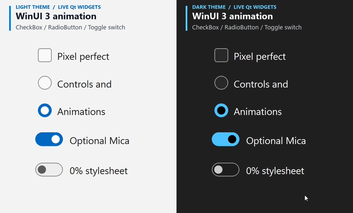
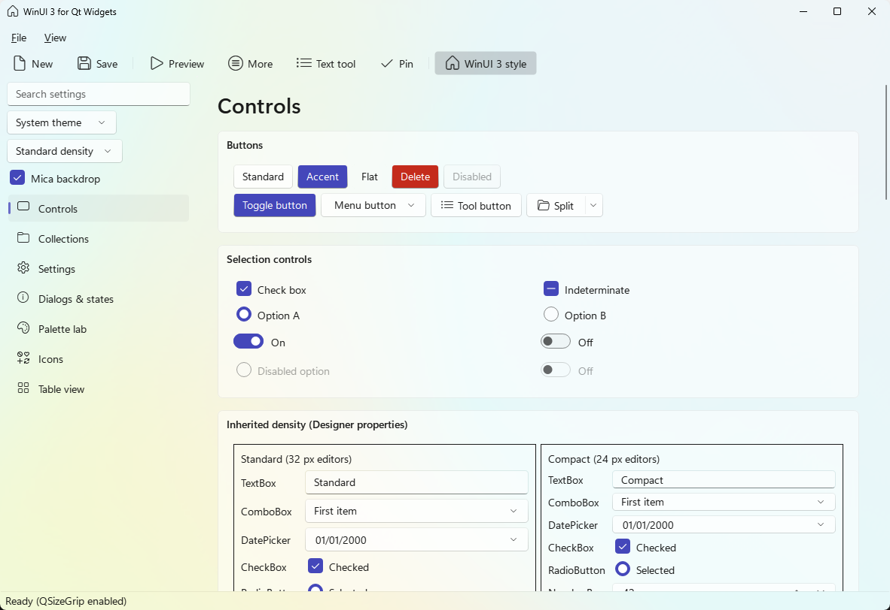
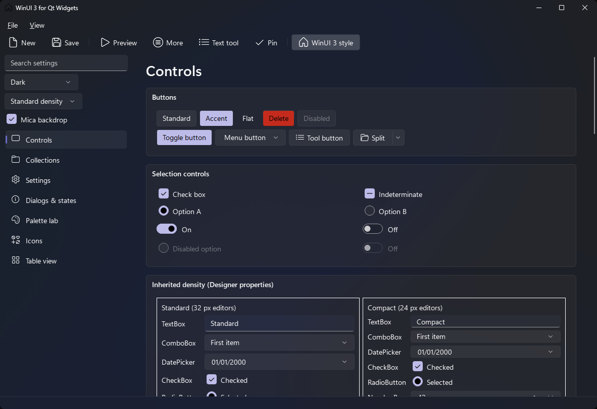

# WinUI3Style

A WinUI 3 `QStyle` for Qt Widgets (Qt 6.5+, with Qt 5.12 fallback), modeled after Windows App SDK 2.4. It styles stock Qt widgets without QSS stylesheet: painting, state animations, light/dark themes, system accent colors, Standard/Compact density, Fluent glyphs, and Windows Mica/Acrylic backdrops.

[](docs/images/winui3style-widgets-live.mp4)

Below the dark and light mode captured with Mica enabled:



> **Work in progress** Control parity is tracked in [docs/coverage.md](docs/coverage.md); see [tools/poc/README.md](tools/poc/README.md) for the portable Windows x64 gallery package.

## Usage

### As a Qt style plugin

Deploy the `qwinui3style` plugin (`qwinui3style.dll` on Windows) into Qt's `styles/` plugin directory. Launch any Qt Widgets app with `-style winui3` or `-style winui3compact`, or load it in code:

```cpp
QApplication::setStyle(QStyleFactory::create(QStringLiteral("winui3")));
```

### From CMake

When included via `add_subdirectory()` or `FetchContent`, tests and the gallery default to `OFF`:

```cmake
add_subdirectory(third_party/WinUI3Style)
target_link_libraries(app PRIVATE WinUI3::Widgets)
```

## Widget variants and density

Variants are configured on stock widgets via dynamic properties (in C++ or Qt Designer's Property Editor):

| Property | Applies to | Values / behavior |
|----------|------------|-------------------|
| `winuiToggleSwitch` | `QCheckBox` | Renders as a ToggleSwitch (`winuiOnText` / `winuiOffText` optional) |
| `winuiControlRole` | Buttons | `standard`, `accent`, `subtle`, `navigation`, `destructive` |
| `winuiVerticalSpinButtons` | `QSpinBox`, `QDoubleSpinBox` | `true` for stacked spin buttons (default is inline) |
| `winuiSettingsCard` | `QFrame`, `QGroupBox` | Styles as a SettingsCard (`winuiSettingsCardExpansion=true` on child, `winuiSettingsCardExpanded` for state) |
| `winuiNavigationView` | Item views | Styles as a NavigationView |
| `winuiContentDialog` | `QDialog` | ContentDialog surface and motion (automatic for `QMessageBox`) |
| `winuiBackdrop` | Top-level window | `none`, `mica`, `mica-alt`, `acrylic` (Windows) |
| `winuiSurface` | Client widgets | `content` or `layer` over a native backdrop |
| `winuiDensity` | Any widget / container | `standard` or `compact` (inherited) |

Global density defaults to Standard for `winui3` and Compact for `winui3compact`, and can be switched at runtime via `style()->setProperty("densityMode", 1)`.

## Build and test

### Windows (MSVC)

```powershell
cmake -S . -B build -G "Visual Studio 17 2022" -A x64 -DCMAKE_PREFIX_PATH=C:/Qt/6.9.2/msvc2022_64
cmake --build build --config Release
ctest --test-dir build -C Release --output-on-failure
```

### Linux / macOS

Windows-only features (Mica/Acrylic backdrops, system appearance watcher, native compositor tests) compile out elsewhere:

```bash
cmake -S . -B build -DCMAKE_BUILD_TYPE=Release
cmake --build build -j"$(nproc)"
ctest --test-dir build --output-on-failure -LE native
```

Pass `-DWINUI_ENABLE_TESTS=OFF` or `-DWINUI3STYLE_BUILD_DEMO=OFF` to omit tests or `winui3style_gallery`. See [docs/METHODOLOGY.md](docs/METHODOLOGY.md) for the visual verification workflow and [docs/coverage.md](docs/coverage.md) for supported controls.
