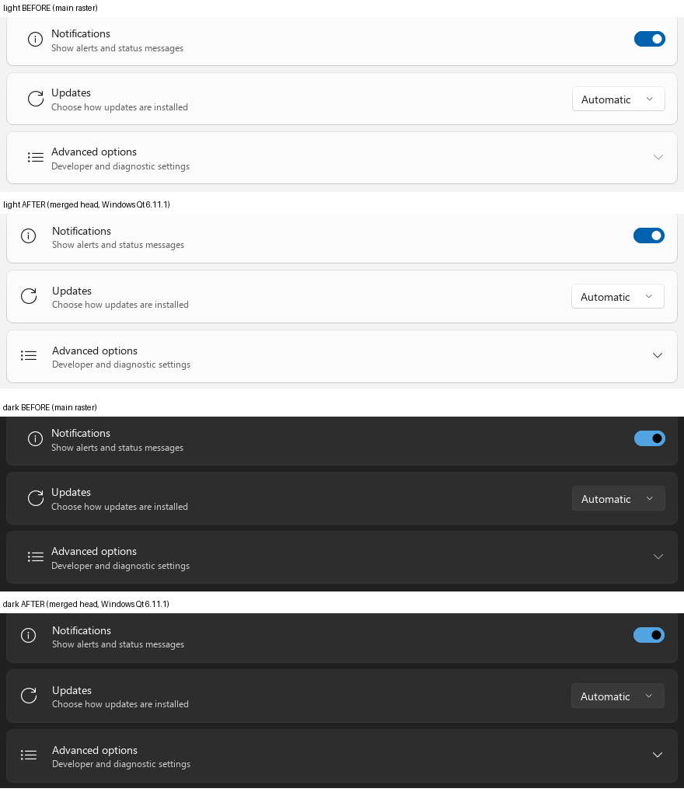

# Issue 56: Settings container validation

## Scope and mapping

Issue: https://github.com/JulienMaille/WinUI3Style/issues/56

The existing stock QFrame/expansion QWidget composition remains in use. QStyle owns the separator, chevron, input state and expansion animation. The compiled SettingsCard helper uses the same content-margin and separator contract. The layout maps one DefaultSettingsExpanderItemStyle item; arbitrary multi-row content and ItemsHeader/ItemsFooter do not claim individual item-template coverage.

The icon starts at border 1 + padding 16 + leading margin 2 = 19 px. The icon occupies a 20 px label with 2 px leading and 20 px trailing margins. A 42 px lane must not center the label in the unused trailing space. The Gallery now mirrors the physical margins in RTL.

The expanded content combines `SettingsExpanderItemPadding` (58,8,44,8), `ExpanderContentDownBorderThickness` (1,0,1,1), item border (0,1,0,0), and `ContentPresenter.Margin` (0,-2,0,0). The effective margins are 59,7,45,9, mirrored horizontally in RTL. The header bottom border remains visible as a one-pixel separator. The item adds its own 1 px top border and MinHeight 52; after presenter overlap and content bottom border, the expansion band has minimum height 51. Header padding also includes the outer 1 px border, so header and content text align at x59.

`ExpanderContentBorderBrush` maps to `CardStrokeColorDefault`: black alpha 15 in Light and black alpha 25 in Dark. This is not the white-alpha-18 Dark `ControlStrokeColorDefault`, nor the flyout stroke. `ExpanderChevronForeground` maps to primary text in normal, hover and pressed states; disabled uses disabled text.

## Exact primary resources

- https://github.com/microsoft/microsoft-ui-xaml/blob/9f89c2da5a5502c263d9268fee224697c47ecb6e/controls/dev/CommonStyles/Common_themeresources_any.xaml
- https://github.com/microsoft/microsoft-ui-xaml/blob/9f89c2da5a5502c263d9268fee224697c47ecb6e/controls/dev/Expander/Expander_themeresources.xaml
- https://github.com/CommunityToolkit/Windows/blob/a2fa47ad72cb95ed81f3ff0885da627a5fd6c14e/components/SettingsControls/src/SettingsCard/SettingsCard.xaml
- https://github.com/CommunityToolkit/Windows/blob/a2fa47ad72cb95ed81f3ff0885da627a5fd6c14e/components/SettingsControls/src/SettingsExpander/SettingsExpander.xaml

The Toolkit sources replace the previous floating `main` citation with an immutable revision. The issue image shows WinUI Gallery 3.0.4.0; the repository manifest pins Gallery 2.9.3.0. The values above come from the exact resource files, not a guessed screenshot measurement.

## Authentic snapshots

`light-before-after.png` and `dark-before-after.png` contain expanded Gallery card crops for Standard and Compact density, before and after the repair. BEFORE uses unchanged origin/main `32b078eeae174dfbee589841502f26671cab7a5f`. AFTER uses this PR's source.

The capture driver instantiates the real GalleryWindow sources and Designer form. It opens the actual Settings page and sends separate mouse move/down/up events to the expansion header. It also replays keyboard expansion and collapse. It captures the native XCB screen with `QScreen::grabWindow(0, ...)`, not mock HTML or a recreated control. All images use Qt 6.8.3, Linux XCB, an isolated Xvnc display, an 1180×780 Gallery window, DPR 1, no backdrop, and settled rest state. The system font differs from Windows Segoe.

The panels add captions only. No image is resized or recolored. The RGBA canvas and alpha composition preserve transparency. BEFORE content margins are 58,8,44,8; AFTER margins are 59,7,45,9. The text changes only because the old sample incorrectly claimed that expansion has no border.

The supplied Windows reference image and pinned XAML support the contract. A live side-by-side Windows Gallery comparison is **not verified** in this Linux session. Coverage remains partial.

## Reproduce and test

The mechanism tests drive the real Gallery composition in Light/Dark × Standard/Compact × LTR/RTL. They assert icon geometry and visible ink, exact content margins, the separator's alpha-composited pixel, and the chevron's primary/disabled-text raster. Compiled-card tests assert full-width expansion, content margins, and exact separator pixels in both themes and densities.

The first run against baseline failed all 32 Gallery cases and all four initial compiled geometry cases. The compiled matrix subsequently added Dark rows. Existing settings-card interaction tests cover expansion, reversal, keyboard input, trailing controls, style replacement and lifecycle behavior.

The strict GCC baseline originally failed at the unused `foreground` local in
`SettingsCard::refreshChevronState`. PR60 has since merged that cleanup; this
branch now merges main (`02e5f56`, PR60 and PR61) and builds warnings-as-errors
without any exception.

## UI brief

Reuse the existing stock labels, layouts, card composition and style paint helpers. Add no widget type, QSS, or widget-local Fluent paint.

Applicable states: collapsed/expanded, hover, pressed, keyboard focus and Space, disabled, RTL, long content, animation and reversal, runtime themes, and both densities. Loading, empty, error/retry, permissions, network success and destructive confirmation do not apply to this static settings demonstration.

Not changed: unrelated card surface/corner styling, QToolBox, issue59 tooltips, PR60/61 behavior, and Windows animation preference.

## CI repair and Windows baseline refresh (2026-11-14)

The first Windows CI head failed clang-tidy and linux-gate on the pre-PR60
unused `foreground` local, and all four msvc-gates on the gallery snapshot
matrix (plus `settingsExpansionSeparator` on three of them). Merging main
`02e5f56` removes the warning blocker and brings the PR61 border compositing
repair; the only merge conflict was the additive probe-test slot list.

The separator probe failure is a test sampling race, not a product defect.
It reproduced locally on Windows Qt 6.11.1 Release, on varying rows per run
(`0-0-0`, `1-1-0`, `1-1-1`; CI showed `0-0-1`). Instrumented geometry showed
the page layout lagging the card's inner QVBoxLayout mid-animation: the card
was momentarily shorter than header minimum plus the animated host band, so
the header was squeezed below its 68 px minimum (e.g. card 87 = header 57 +
host 30) while the probe read the seam at the first `height() > 0` tick.
Layout requests settle before paint requests, so no squeezed frame is
rendered. The probe now waits for full convergence
(`maximumHeight() == QWIDGETSIZE_MAX` and `height() >= 51`), exactly like
`settingsExpansionMargins`, before asserting the seam and hairline pixels.
Four consecutive full probe runs pass. No product code changed.

The snapshot matrix failed because the four Settings page captures still
held the pre-repair raster. Refreshed baselines:
`light-page-2.png`, `dark-page-2.png`, `light-density-compact-page-2.png`,
`dark-density-compact-page-2.png`, copied from the merged-head offscreen
Windows capture (local Qt 6.11.1 MSVC Release, Segoe UI, DPR 1, animations
disabled, two identical runs). Audit: 68-file manifest unchanged, 64 captures
byte-identical, only the four Settings pages differ, changed bounding boxes
confined to the card stack (288,144)-(1151,357). Numeric spot checks: Light
chevron darkest ink 162 -> 67 and Dark brightest ink 160 -> 238, the pinned
secondary -> primary text change; icon leading inset 19 px and the
`CardStrokeColorDefault` seam remain asserted by the mechanism probes.
The refreshed matrix passes pixel-exact locally. Current-head Windows CI
remains pending; the official Windows side-by-side comparison is still
unverified and coverage remains partial.

