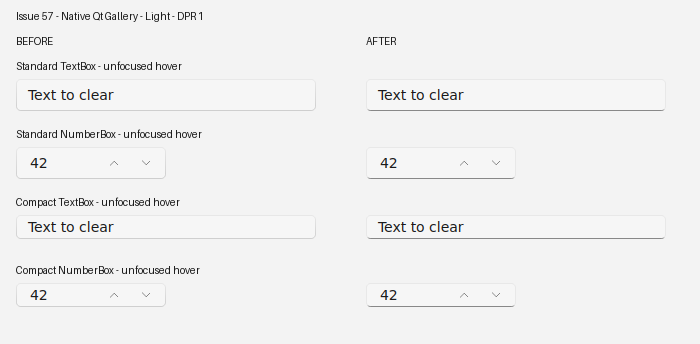
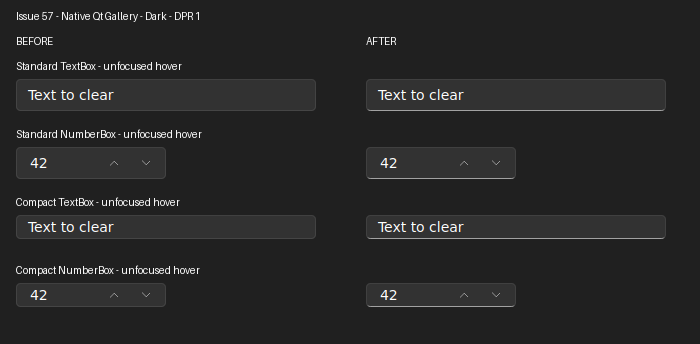

# Issue 57: unfocused editor elevation border

## Mapping and source

QLineEdit maps to TextBox. QSpinBox and QDoubleSpinBox map to NumberBox's
TextBox-based InputBox. The stacked button layout remains a Qt extension.

Pinned Microsoft sources:
- https://github.com/microsoft/microsoft-ui-xaml/blob/9f89c2da5a5502c263d9268fee224697c47ecb6e/controls/dev/CommonStyles/TextBox_themeresources_perf2026.xaml
- https://github.com/microsoft/microsoft-ui-xaml/blob/9f89c2da5a5502c263d9268fee224697c47ecb6e/controls/dev/CommonStyles/Common_themeresources_any.xaml
- https://github.com/microsoft/microsoft-ui-xaml/blob/9f89c2da5a5502c263d9268fee224697c47ecb6e/controls/dev/NumberBox/NumberBox.xaml

Normal and PointerOver select TextControlElevationBorderBrush. Its absolute
2 DIP gradient reverses vertically. The final 1 DIP uses
ControlStrongStrokeColorDefault (#72000000 Light, #8BFFFFFF Dark).
The rest of the border uses ControlStrokeColorDefault. Disabled selects a
uniform default stroke. Focused controls retain the entire original surface and accent paint path.
Unfocused controls now use the pinned 1 DIP logical border, rather than a
cosmetic 1 device pixel border. At 200%, each unfocused edge spans 2 physical
pixels. This deliberate DPI correction follows the pinned template geometry.
QTimeEdit and QDateTimeEdit without a calendar popup inherit the NumberBox
frame. Calendar-popup date editors retain the unchanged ComboBox frame.
No new color token or thicker resting underline is necessary.

## Authentic Gallery snapshots

The panels contain unscaled widget captures from the real GalleryWindow,
compiled from the repository's Gallery sources. Labels and spacing sit outside
the captures. No control pixels were edited. The two columns use the same
native XCB display, Qt 6.8.3, DPR 1, and Linux system font fallback.

Before: origin/main at 32b078eeae174dfbee589841502f26671cab7a5f.
After: issue 57 implementation on vorflux/fix-unfocused-editor-frame.
Each panel shows Standard and Compact, TextBox and NumberBox, unfocused hover.
Real pointer move, down, up, leave and Tab/Shift+Tab input ran in the Gallery.
Separate focused and disabled captures were also retained as session evidence.

## Verification scope

The editor regression covers Light/Dark, Standard/Compact, TextBox,
inline/stacked NumberBox, rest/hover/disabled/focus, LTR/RTL and
1/1.25/1.5/2 raster scale. Token and geometry assertions accompany pixel checks.
The initial implementation failed the new border contract before the repair.

These are Linux Qt Gallery captures, not official WinUI screenshots.
The Windows official Gallery side-by-side comparison, Windows compositor,
and approved Windows snapshot matrix remain unverified here.
The coverage ledger remains partial.

Not changed: ComboBox, tooltip, calendar-popup date editor, editor fill, padding, size,
keyboard semantics, and step-button geometry.
