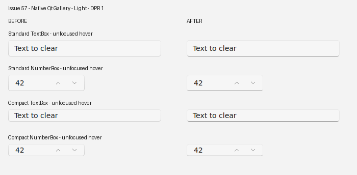
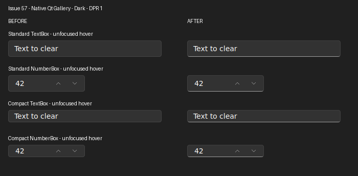

# Issue 57: unfocused editor elevation border

## Mapping and source

QLineEdit maps to TextBox. QSpinBox and QDoubleSpinBox map to NumberBox's
TextBox-based InputBox. The stacked button layout remains a Qt extension.

Pinned Microsoft sources:
- https://github.com/microsoft/microsoft-ui-xaml/blob/9f89c2da5a5502c263d9268fee224697c47ecb6e/controls/dev/CommonStyles/TextBox_themeresources_perf2026.xaml
- https://github.com/microsoft/microsoft-ui-xaml/blob/9f89c2da5a5502c263d9268fee224697c47ecb6e/controls/dev/CommonStyles/Common_themeresources_any.xaml
- https://github.com/microsoft/microsoft-ui-xaml/blob/9f89c2da5a5502c263d9268fee224697c47ecb6e/controls/dev/NumberBox/NumberBox.xaml

Normal and PointerOver select TextControlElevationBorderBrush. Its absolute
2 DIP gradient reverses vertically. The final 1 DIP uses
ControlStrongStrokeColorDefault (#72000000 Light, #8BFFFFFF Dark).
The rest of the border uses ControlStrokeColorDefault. Disabled selects a
uniform default stroke. Focused controls retain the entire original surface and accent paint path.
Unfocused controls now use the pinned 1 DIP logical border, rather than a
cosmetic 1 device pixel border. At 200%, each unfocused edge spans 2 physical
pixels. This deliberate DPI correction follows the pinned template geometry.
QTimeEdit and QDateTimeEdit without a calendar popup inherit the NumberBox
frame. Calendar-popup date editors retain the unchanged ComboBox frame.
No new color token or thicker resting underline is necessary.

## Authentic Gallery snapshots

The panels contain unscaled widget captures from the real GalleryWindow,
compiled from the repository's Gallery sources. Labels and spacing sit outside
the captures. No control pixels were edited. The two columns use the same
native XCB display, Qt 6.8.3, DPR 1, and Linux system font fallback.

Before: origin/main at 32b078eeae174dfbee589841502f26671cab7a5f.
After: issue 57 implementation on vorflux/fix-unfocused-editor-frame.
Each panel shows Standard and Compact, TextBox and NumberBox, unfocused hover.
Real pointer move, down, up, leave and Tab/Shift+Tab input ran in the Gallery.
Separate focused and disabled captures were also retained as session evidence.

## Verification scope

The editor regression covers Light/Dark, Standard/Compact, TextBox,
inline/stacked NumberBox, rest/hover/disabled/focus, LTR/RTL and
1/1.25/1.5/2 raster scale. Token and geometry assertions accompany pixel checks.
The initial implementation failed the new border contract before the repair.

These are Linux Qt Gallery captures, not official WinUI screenshots.
Authentic Windows CI artifacts now supply the reviewed snapshot refresh.
See [Windows snapshot review](approval-review.md) for provenance and the
complete pixel audit. Current-head Windows CI remains pending.
The Windows official Gallery side-by-side comparison and native Windows
compositor remain unverified. The coverage ledger remains partial.

Not changed: ComboBox, tooltip, calendar-popup date editor, editor fill, padding, size,
keyboard semantics, and step-button geometry.

## Windows test fixture correction

Windows CI exposed a mixed-density test fixture, not a layout change.
The local Style was Compact, but null-widget sizing consulted the Standard
application Style for one branch. With Segoe-sized font metrics, all 192
Compact rows expected 24 pixels but received 27. The fixture now binds its
widget to the local Style and passes that widget to sizing. A controlled
16-pixel font reproduces the original failure on Linux. All 460 editor checks
pass after the correction. Product sizing code remains unchanged.

Windows uses a 21-pixel line height for this 16-pixel font. The existing
sizing contract therefore returns 33 pixels for Standard and 29 for Compact.
The test now derives size expectations from the density padding and actual
font metrics. It checks both 16- and 24-pixel fonts. The border raster still
uses the pinned minimum-height canvas; product sizing remains unchanged.

Current-head Windows Qt 6.8.3 Debug CI accepted the refreshed snapshot matrix
but exposed this font-growth assertion. The font-aware test correction needs
a new Windows result before the full gate can pass.

## Border compositing follow-up (2026-11-14)

A live dark-mode report showed every input widget's resting border compositing
over the control fill instead of the parent surface: XAML `Border` insets the
background inside the border ring, while `borderedSurface` filled to the edge
and stroked inside. The pinned stroke tokens were correct; only the composite
order deviated (Dark ~14 gray levels, Light ~2-3, which is why earlier reviews
missed it). The fill is now inset by the stroke extent for every
`controlSurface`/`editorSurface` caller, including the focused path and popup
frames. The editor contract test asserts stroke-over-surface rings (288 rows
RED before the fix) and the button outer-pixel contract was corrected to the
same semantics. The 50-PNG Windows baseline refresh is thin-band audited in
[approval-review.md](approval-review.md); see
issue57-border-compositing-before-after.png. Focused captures are no longer
byte-identical to main. Official Windows side-by-side remains outstanding.
